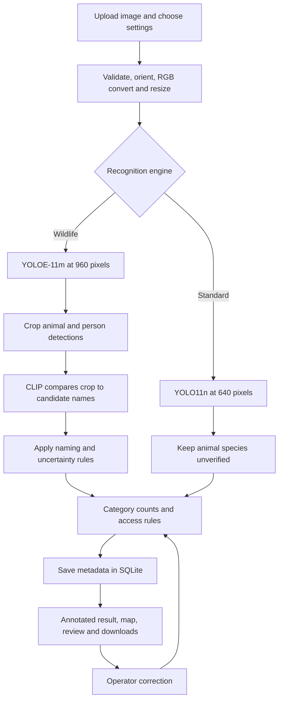

# VanRakshak — Current Prototype and Team Handoff

**Code snapshot: 18 October 2026.** This guide describes the files currently in the project. Sections labeled **planned** describe work that has not been implemented. It does not claim high detection accuracy or completed custom training.

## 1. Start here

VanRakshak is a local Python application for analyzing wildlife imagery. A user uploads a photograph, selects a recognition engine and access settings, and receives bounding boxes, object-name estimates, category counts and a rule-based access alert. The application saves observation metadata and provides camera-level mapping, review states and report downloads.

**Project location on the development laptop:**

```text
C:\Users\mayan\Documents\Codex\2026-10-18\ai-powered-wildlife-monitoring-threat-detection\VanRakshak
```

The project is directly inside the workspace root. `outputs/VanRakshak.zip`, one directory above this project, is a shareable source package; it is not the working checkout. Its virtual environment and naming-weight cache are excluded.

**What the team should understand immediately:**

- Image analysis is implemented. Video upload, live feeds and tracking are not.
- Models are pretrained. Preparing a vocabulary is not custom training.
- Species names are estimates. The gorilla-versus-person failure remains a known limitation.
- A person or vehicle is not automatically a threat. Access alerts use operator-supplied settings.
- The app runs on the laptop at `http://127.0.0.1:8501`. It has not been hosted online.

## 2. Run the existing project on this laptop

### Easiest method

Open the project folder in File Explorer and double-click **start.cmd**. Keep its terminal open. Visit [VanRakshak locally](http://127.0.0.1:8501).

### PowerShell commands

```powershell
Set-Location -LiteralPath 'C:\Users\mayan\Documents\Codex\2026-10-18\ai-powered-wildlife-monitoring-threat-detection\VanRakshak'
.\start.cmd
```

Or launch Streamlit directly:

```powershell
.\.venv\Scripts\python.exe -m streamlit run app.py --server.address 127.0.0.1 --server.port 8501
```

These commands use the project environment explicitly; activation is unnecessary. They avoid the Windows Store `python` alias, which did not work on the development laptop. Press **Ctrl+C** in the serving terminal to stop the app.

If the dashboard is already running, open the address instead of starting another instance. If port 8501 is occupied by another application, use:

```powershell
.\.venv\Scripts\python.exe -m streamlit run app.py --server.address 127.0.0.1 --server.port 8502
```

Then visit `http://127.0.0.1:8502`. Loopback addresses are accessible on that computer, not through the same URL on teammates' computers.

## 3. Set up a teammate's Windows laptop

Install **Python 3.12**, including the Python launcher and pip. Extract the supplied ZIP into a folder such as `C:\Projects\VanRakshak`. Use the folder containing `app.py`; do not accidentally stop at a parent ZIP-extraction folder.

Do not copy or reuse another machine's `.venv`. If sharing a manually copied folder, omit `.venv` before copying and create a fresh environment at the destination. Keep the prepared detector in `models/vanrakshak-wildlife.pt` and the standard model in `models/yolo11n.pt` when possible.

### Setup script

```powershell
Set-Location -LiteralPath 'C:\Projects\VanRakshak'
powershell -ExecutionPolicy Bypass -File .\setup.ps1
.\start.cmd
```

The execution-policy override applies only to that PowerShell process. The script checks for Python 3.10–3.12, creates an environment if needed, installs CPU PyTorch and project requirements, and prepares/downloads model assets. It prefers the bundled Codex Python when available; otherwise it tries the Python launcher or `python`.

If the script chooses an incompatible Python version, use the explicit Python 3.12 sequence below in a fresh extracted folder.

### Manual setup with a standard Python installation

```powershell
Set-Location -LiteralPath 'C:\Projects\VanRakshak'
py -3.12 --version
py -3.12 -m venv .venv
.\.venv\Scripts\python.exe -m pip install --upgrade pip
.\.venv\Scripts\python.exe -m pip install --no-compile torch torchvision --index-url https://download.pytorch.org/whl/cpu
.\.venv\Scripts\python.exe -m pip install --no-compile -r requirements.txt
.\.venv\Scripts\python.exe download_model.py
.\start.cmd
```

Internet is needed for package and initial weight downloads. The prepared Wildlife detector is about **57.6 MiB**, the Standard detector **5.4 MiB**, and the CLIP naming cache **337.6 MiB**. These file sizes are not RAM requirements. Allow several GB of free disk space for dependencies and setup assets. If the prepared Wildlife weights are absent, preparation also downloads a larger text encoder. No API key is required by the implemented inference path.

After setup, image inference and local history work offline. Map tiles require internet. First-time model loading is slower than later analyses.

### Verify installation

From the project folder:

```powershell
.\.venv\Scripts\python.exe -c "import streamlit, ultralytics, torch; print(streamlit.__version__, ultralytics.__version__, torch.__version__)"
.\.venv\Scripts\python.exe -m unittest discover -s tests -v
.\.venv\Scripts\python.exe smoke_test.py
```

There are currently **nine regression checks**. The smoke test runs actual inference on included people/bus, giraffe, zebra and gorilla photographs and writes annotated results to `samples/verified/`. Test success does not establish general accuracy.

## 4. What is implemented

| Capability | Current behavior |
|---|---|
| Upload | JPG, JPEG, PNG and WebP; configured 15 MB limit and 24-megapixel check |
| Preprocessing | Correct EXIF orientation, convert to RGB, shrink to fit 1920 × 1920 while preserving aspect ratio |
| Detection | Wildlife or Standard engine, confidence threshold and bounding boxes |
| Naming | Wildlife uses crop-level CLIP comparison; uncertain names stay reviewable |
| Categories | Animal, Human, Vehicle and Other, inferred from the resulting label |
| Access assessment | Restricted-location/authorized-visit rules supplied by the operator |
| Location | Optional latitude and longitude for a camera; no automatic image GPS extraction |
| History | Local SQLite metadata; latest 500 observations displayed |
| Correction | Correct/remove objects in the current result; update annotation, saved detections and alert |
| Review | Unreviewed, Investigating, Resolved or False alarm |
| Export | Annotated PNG, per-observation JSON and history CSV |
| Visibility advisory | Mean grayscale brightness below 65 produces a low-light advisory |

The brightness check does not enhance the image or quantify model reliability. The app has no scripted-results mode or presentation guide in its interface.

## 5. Architecture and complete image flow

Streamlit provides the browser interface and runs the Python application. YOLO models perform localization; CLIP supplies a second naming step in Wildlife mode. SQLite saves metadata on the same machine. There is no separate API server or external inference service in the current design.



The same flow in text: **upload → preprocess → locate objects → optionally estimate names from crops → retain uncertainty → assess access context → save → review/export**.

### Step-by-step code path

1. `app.py` reads the uploaded file and sidebar settings. Analysis is disabled until an image is available and any selected custom camera has both coordinates.
2. `model(profile)` uses `st.cache_resource` to cache an engine instead of reloading its weights on every widget interaction.
3. `detector.load_model()` selects local model weights. Both inference profiles explicitly use **CPU**; GPU inference is not currently selected automatically.
4. `detector.predict()` runs YOLO with the selected confidence threshold, class-agnostic non-maximum suppression and IoU threshold **0.5**. NMS suppresses overlapping boxes; it is not tracking and can still merge nearby objects or leave duplicates.
5. Boxes are stored as pixel coordinates `[x1, y1, x2, y2]` in the **preprocessed image**, not necessarily the original full-resolution upload.
6. Wildlife calls `naming.refine_names()` on valid animal/person crops. The naming model cannot independently find an animal that the detector never boxed.
7. `core.verification_labels()` prevents unsupported Standard animal guesses from appearing as confirmed species. Wildlife named candidates remain estimates with `verified=False`.
8. `core.assess()` calculates the access status. `save_observation()` assigns an ID and the current UTC analysis timestamp.
9. `core.annotate()` draws boxes; `app.py` displays counts, predictions, scores and reports. Original and annotated pixels remain in the active session.
10. Saving a correction runs `correct_detections()`, recalculates the access status, updates SQLite and regenerates the current annotated image. The review state resets to Unreviewed. It does **not** retrain a model.

A process-wide reentrant lock serializes detector/naming inference. This helps avoid shared-model inference races, but it does not create a background queue or make the application ready for high concurrent traffic.

## 6. Understand the two engines

| Detail | Wildlife — default | Standard |
|---|---|---|
| Detector | YOLOE-11m, prepared named-target weights | YOLO11n |
| Inference size | 960 pixels | 640 pixels |
| Second naming stage | CLIP ViT-B/32 | None |
| Vocabulary | 47 detector targets; 40 naming candidates | Original COCO categories |
| Animal output | Estimated name or unverified animal | Unverified animal, raw model guess retained |
| Tradeoff | Broader name coverage, slower and still fallible | Faster, limited species coverage |

`vocabulary.py` defines **31 wildlife names** and **16 other targets**. Wildlife names include gorilla, chimpanzee, monkey, elephant, rhinoceros, hippopotamus, giraffe, zebra, deer, antelope, buffalo, bison, wild boar, bear, tiger, lion, leopard, cheetah, wolf, fox, hyena, crocodile, snake, turtle, bird, dog, cat, horse, cow, sheep and goat. These are target labels, not proof of validated species recognition; several are broad animal categories.

Other targets include person, common vehicles, backpack, tent, chair, bench, bottle, traffic sign and fence. CLIP naming uses the 31 wildlife names plus person and eight vehicle names (`car`, `truck`, `bus`, `motorcycle`, `bicycle`, `boat`, `airplane`, `train`), giving **40 total**. Objects such as tents are not passed through the crop namer.

`prepare_wildlife.py` encodes the configured names into YOLOE and saves `vanrakshak-wildlife.pt`; it removes the preparation encoder before saving. It does not change the detector through labeled-image training. Changing `vocabulary.py` alone does not update the prepared detector: rerun preparation and restart the app, then validate the new classes. Naming prompts are encoded when the naming model loads.

`prepare_world.py` and YOLO-World weights may remain in the development folder as experiment artifacts. They are **not used by either current engine**. The YOLO-World experiment was rejected after recognition failures.

## 7. Naming scores and uncertainty: what the app actually does

CLIP turns each crop and candidate text into normalized vectors, compares them using cosine similarity and keeps the top three candidates. Text prompts have the form `a photo of a gorilla`, for example.

Current heuristic rules in `naming.py`:

- For a detector animal, accept a candidate wildlife estimate when top similarity is at least **0.24** and its lead over the second candidate is at least **0.015**.
- If detector and crop namer agree on the species and detection score is at least **0.6**, that estimate may remain even with a smaller margin. Close alternatives are explicitly recorded.
- Otherwise, keep `animal (unverified)`.
- If the detector says person but the crop namer prefers an animal, retain the possible person and mark **Conflicting predictions — review**.
- Person crops that do not prefer an animal retain the person prediction. Vehicles and non-animal/non-person objects skip this crop naming step.

These thresholds are operating heuristics, not calibrated accuracy guarantees.

**Detection score** comes from YOLO. **Name similarity** is cosine similarity, not a percentage probability. A detector's 94% score must not be interpreted as 94% confidence in a separately assigned gorilla name. Original detector labels and model scores are retained for traceability. Operator confirmations have their own flag.

### Important current failure

The user's image with people and gorillas can still label gorillas as people. Even when the naming model disagrees, the current UI still shows `person`, counts it as Human, and `assess()` may use it in an access alert. The warning does **not** fix that label or make the count confirmed.

The newer screenshot in the conversation was not a completed independent benchmark. Earlier example checks found a correct clean-photo gorilla estimate, while the screenshot still contained false people/sign detections. Do not claim this problem is solved. Fixing the uncertainty-to-count/alert behavior is the first priority in Section 12.

## 8. Access alerts and mapping

| Detected person/vehicle? | Restricted? | Operator-confirmed authorized? | Status |
|---|---|---|---|
| Yes | Yes | No | Review required / potential intrusion |
| Yes | Either | Yes | Authorized activity |
| Yes | No | No | Activity observed |
| No, but other detections exist | Either | Either | No rule triggered |
| No detections | Either | Either | No detections |

These rules use the current labels, including disputed possible humans. They do not recognize uniforms, employee identities, permits, intent or poaching. Both access toggles default to off. Toggling settings after an analysis does not retroactively rewrite the saved observation; analyze again to use new settings.

**Mapping:** enter a custom camera's latitude and longitude to place its detected activity on the map. No assigned location means no pin. Pins are deduplicated camera coordinates and are not individual object locations. There are no polygon boundaries, drone georeferencing, GPS extraction or movement paths. Old illustrative camera constants remain only for legacy-record handling; they are not current selectable locations.

## 9. Storage, reports and source-file map

Database: `data/observations.sqlite3`. Table: `observations`.

| Stored fields | Meaning |
|---|---|
| `id`, `captured_at` | Generated observation ID and UTC analysis time; not original capture time |
| `mode`, `camera`, `lat`, `lon` | Analysis source label and supplied camera position; coordinates may be null |
| `source` | Upload filename |
| `restricted`, `authorized`, `threshold` | Settings used for that analysis |
| `status`, `reason`, `review` | Access-rule result and ranger review state |
| `detections` | JSON list containing labels, boxes, scores and available naming provenance |

Each Analyze click creates a new observation, even for the same image. Counts are per observation, not unique animals. The view is limited to the latest 500 records; the database may contain more.

PNG downloads contain the annotation. JSON contains the current observation details and detection provenance. History CSV is a summary and does not include every crop score or bounding box. The cached source pixels are not persisted in SQLite, so old images cannot currently be reopened for full correction from the history table. Current label correction is available for the active result; historical review-state updates are available separately. Model loading/profile is saved per detection where present, not as a dedicated observation-table column.

```text
VanRakshak/
├── app.py                    # Streamlit UI, upload, processing orchestration
├── core.py                   # Categories, access rules, annotations, SQLite, review
├── detector.py               # Engine loading, YOLO inference, inference lock
├── naming.py                 # CLIP crop naming and uncertainty heuristics
├── vocabulary.py             # Configured target names
├── prepare_wildlife.py       # Bake YOLOE target embeddings; not fine-tuning
├── download_model.py         # Standard weights, Wildlife preparation if needed, naming setup
├── download_namer.py         # Download/cache CLIP naming weights
├── start.cmd                 # Windows launch shortcut
├── setup.ps1                 # Windows dependency and model setup
├── requirements.txt          # Python dependency declaration
├── .streamlit/config.toml    # Theme, 15 MB upload limit, Streamlit usage stats disabled
├── models/                   # Detector weights; may also contain setup experiments
├── .runtime/clip/            # CLIP naming weights
├── data/                     # Local observation database
├── samples/                  # Real test photos and source/license details
├── evaluation/               # Small comparison evidence and limitations
├── tests/                    # Nine regression checks
├── smoke_test.py             # Real model/photo check
├── README.md                 # Short setup guide
└── CURRENT_PROTOTYPE.md      # This handoff
```

Runtime checked on the development laptop: Python **3.12.14**, Streamlit **1.50.0**, Ultralytics **8.3.221**, CPU PyTorch **2.14.1+cpu**, torchvision **0.29.1+cpu**, Pillow **11.3.0**, CLIP package **1.0**. `requirements.txt` pins the main app libraries but is not a full dependency lockfile; another installation may resolve different transitive versions.

## 10. What validation currently proves

Nine regression checks cover context-based alerts, label verification, operator correction/removal, storage, migration to optional coordinates, the dashboard workflow, naming uncertainty, close alternatives and person/namer disagreements. Most use controlled inputs or mocks; they verify application behavior, not real-world model accuracy.

`evaluation/upgrade.json` records a small real-inference comparison at threshold 0.35. The available checks included giraffes, zebra, people/bus, a clean gorilla photograph and an annotated screenshot. The Wildlife path named the clean gorilla where the original detector guessed bear; the screenshot retained errors. Some samples may overlap pretraining, and examples were inspected during development. There is **no held-out reserve benchmark, mAP result or defensible overall accuracy percentage**.

Recorded CPU inference was approximately 0.2–0.32 seconds/image for Standard and 1.17–3.52 seconds/image for Wildlife after loading in one comparison. These are observations, not service guarantees. See `evaluation/RESULTS.md` and `samples/SOURCES.md` for evidence and attribution.

## 11. Definition of a complete hackathon version

Build a focused, explainable monitoring workflow rather than promise every species in every condition. The proposed completion scope is:

1. Image and short-video upload with visible progress and useful failures.
2. Detection of people, vehicles and an agreed, evaluated subset of wildlife.
3. Explicit estimated/uncertain/operator-confirmed states, with counts and alerts reflecting them correctly.
4. Camera-level map, timestamped observations and an evidence-backed review workflow.
5. Downloadable results and a documented, repeatable installation.
6. An untouched test set with per-class detection, naming and false-alert results.

This is a proposed scope, not functionality already completed. Live drones, continuous camera ingestion, automatic authorization, individual re-identification and production deployment are outside the first completion milestone.

## 12. Priority implementation plan

| Priority | Work | Where to change | Acceptance condition |
|---|---|---|---|
| P0 | Treat disputed identities explicitly | `naming.py`, `core.category()`, `core.assess()`, counts/table/annotation in `app.py` | A gorilla/person disagreement appears as uncertain activity; possible-person and operator-confirmed-human counts are separate. No confident intrusion claim follows from a disputed identity. Preserve review urgency. |
| P0 | Regression cases from the failure | `tests/` plus a separately kept image collection | Verify counts, annotations, exports and alert state agree for uncertain objects, not just that a warning exists. |
| P1 | Persist evidence for historical review | `core.py` schema and `app.py` history | Reopen the source frame, see old/new labels and reviewer/time, and correct an older observation without re-uploading. Do not overwrite raw model output. |
| P1 | Short-video frame analysis | New `video.py`, upload UI and frame metadata | Bounded work, frame timestamps, progress, cancellation and per-frame results; counts explicitly not unique animals. |
| P1 | Focused model/data evaluation | Dataset preparation and evaluation scripts | Measured per-class errors on unseen data, including blank scenes and confusing animals. |
| P2 | Custom fine-tuning if data/GPU are ready | Separate training scripts; detector integration | A candidate beats the frozen baseline on validation criteria, then is assessed once on the untouched test set. |
| P2 | Tracking/event grouping | Video pipeline and event storage | Stable IDs reduce repeated alerts; no claim of unique animal population estimates. |
| P3 | Hosted/team access | Deployment, authentication, durable storage | Documented access, model provisioning, resource checks and restart-safe records. |

### Planned video implementation

Reuse `detector.predict()`, naming, annotation and access rules. Add MP4 upload, save to a bounded temporary path, read metadata/frames with OpenCV, and analyze frames at configurable time intervals. OpenCV is currently a transitive dependency; declare its version directly when the app starts depending on it.

Start with short clips and a cap such as **30 sampled frames**, then measure processing time. Approximate work is `number of sampled frames × measured seconds per frame`, plus decode/load overhead. Sampling every second can miss brief events, and it does not track identities. Save `video_id`, frame index, source-video timestamp and frame evidence; release file handles and clean temporary files. Add progress/cancellation and codec/empty-file handling.

Tracking is a later step. Ultralytics provides tracking APIs, but using them still requires integrating state, IDs and event grouping into this app; see the [official tracking guide](https://docs.ultralytics.com/modes/track/).

## 13. How to pursue higher accuracy properly — planned

Agree on a small class list supported by suitable data. An example starting list is **person, car, truck, elephant, gorilla, deer and zebra**; the team must confirm that it matches its intended reserve and data. Do not advertise classes just because their names can be added to the vocabulary.

Collect licensed, correctly labeled images from the intended viewpoints. Include empty scenes, authorized people, shadows, vehicles at distance, partially visible animals and confusing species. Keep source/license records and audit annotations. Build disjoint training, validation and test sets by camera/site/video where possible; adjacent video frames must not leak into different splits. There is no universal image-count threshold that guarantees accuracy. The [official dataset format](https://docs.ultralytics.com/datasets/detect/) explains YOLO labels and dataset configuration.

Train a detector on a GPU-capable environment. The current app installs **CPU** PyTorch and hardcodes CPU inference, so it is not already a GPU training setup. Use the appropriate build from [PyTorch's official installation guidance](https://pytorch.org/get-started/locally/), verify CUDA availability, and keep training experiments separate from the working app.

### Example future dataset layout and configuration

**The folders/config below do not exist in the current project. Create and populate them before running the following template commands.**

```text
datasets/wildlife/
├── images/train/   images/val/   images/test/
├── labels/train/   labels/val/   labels/test/
└── data.yaml
```

Example `data.yaml` for the proposed seven classes; replace `path` with the actual absolute dataset location on the training machine:

```yaml
path: C:/Datasets/VanRakshak/wildlife
train: images/train
val: images/val
test: images/test
names:
  0: person
  1: car
  2: truck
  3: elephant
  4: gorilla
  5: deer
  6: zebra
```

Each corresponding label text file uses `class_id x_center y_center width height`, with coordinates normalized to the image dimensions. Empty scenes should have no object boxes, rather than invented background objects.

### Example future training commands

**Training-machine template only.** Activate a suitable training environment, ensure the dataset file exists at the given path and verify a working CUDA installation. These commands have not been run to train this prototype.

```powershell
python -c "import torch; print(torch.__version__); print(torch.cuda.is_available())"
python -c "from ultralytics import YOLO; YOLO('yolo11s.pt').train(data='C:/Datasets/VanRakshak/wildlife/data.yaml', epochs=50, imgsz=640, batch=8, device=0, workers=0, project='training_runs', name='wildlife_v1', exist_ok=False)"
```

The initial weights require downloading if absent. Epochs, image size and batch are starting settings, not a promised recipe. `device=0` requires a CUDA-capable training setup; do not expect it to work in the current CPU-only app environment. `workers=0` simplifies Windows multiprocessing for this template. Training time depends on data and hardware. See [Ultralytics training documentation](https://docs.ultralytics.com/modes/train/).

Tune on validation data. Once the model, thresholds and preprocessing are frozen, evaluate on the untouched test split:

```powershell
python -c "from ultralytics import YOLO; m=YOLO('training_runs/wildlife_v1/weights/best.pt'); r=m.val(data='C:/Datasets/VanRakshak/wildlife/data.yaml', split='test', imgsz=640, device=0, workers=0); print(r.results_dict)"
```

Run from the same training working directory; that weights path is a future output, not a file supplied here. See [Ultralytics validation documentation](https://docs.ultralytics.com/modes/val/).

Measure object localization and species naming separately. Report per-class precision, recall, mAP, confusion cases, false access alerts per image or video minute, and latency on the laptop that will run the app. Missing a possible human and falsely flagging an animal have different operational costs. Choose thresholds on validation data rather than repeatedly tuning to the test images.

After evaluation, copy the chosen weights into `models/`, add a proper custom-detector loading path in `detector.py`, align class names/categories, decide whether CLIP helps or hurts on validation data, and extend tests. **Do not rename arbitrary trained YOLO weights to `vanrakshak-wildlife.pt`: the current loader expects a YOLOE model there.**

## 14. Suggested team split and completion checks

If there are four teammates, a useful division is:

| Owner | Responsibility | Required handoff |
|---|---|---|
| A | Data, labels and frozen evaluation | Class list, dataset provenance, disjoint splits, error report |
| B | Detector/naming and uncertainty | Candidate model, measured tradeoffs, consistent object states |
| C | Video and observation storage | Timestamped frame pipeline, bounded runtime, saved evidence |
| D | Dashboard integration and release | Review/count/alert UX, setup verification, packaged source |

With fewer people, combine roles. Agree on detection-result fields before simultaneous edits; avoid editing the same files without coordination. Every new capability needs a concrete acceptance check, not just a visible button.

For a short hackathon schedule: first fix disputed identities and reproduce the known failure; next finish evidence-backed image review; then add bounded video sampling; finally freeze the release and run a fresh-machine setup plus the agreed test collection. Begin custom training only if labeled data and a GPU are available early. A completed image workflow is preferable to claiming an unfinished video or training feature.

Release checklist:

- [ ] A teammate can install and run the folder using Section 3.
- [ ] Declared classes and implemented inputs match the actual app.
- [ ] Disputed species/people are not presented as confirmed counts.
- [ ] Alerts use access context and preserve uncertainty.
- [ ] Locationless uploads do not acquire invented map coordinates.
- [ ] Original and corrected results are traceable, with retained evidence if implemented.
- [ ] Video limits, timestamps and non-unique counts are clear if video is implemented.
- [ ] Regression checks and real-image checks pass; known failures are documented.
- [ ] Accuracy claims match an independent evaluation, or explicitly state that none exists.
- [ ] The source package includes current documentation, setup scripts and model provisioning.

## 15. Hosting, troubleshooting and project claims

**Hosting — planned:** Streamlit is the UI framework, not evidence of online deployment. A hosted version needs deployable source/dependencies, reproducible weight provisioning, enough memory for YOLOE plus CLIP, and durable observation storage. The current `.gitignore` excludes model weights and caches, so pushing the code alone will not provision them. Authentication and isolation are absent. Test resource usage before choosing a host; see [Streamlit dependency guidance](https://docs.streamlit.io/deploy/concepts/dependencies) and [Community Cloud resource guidance](https://docs.streamlit.io/deploy/streamlit-community-cloud/manage-your-app). No public endpoint is currently part of the deliverable.

| Problem | First action |
|---|---|
| `python` opens the Store or is missing | Use the existing `.venv\\Scripts\\python.exe`; on a new laptop install Python 3.12 and use `py -3.12`. |
| Missing Streamlit/Ultralytics/CLIP | Run setup from the correct folder/environment; inspect the first installation error. |
| Missing detector/naming weights | Run `.\.venv\Scripts\python.exe download_model.py` while online. |
| Port already in use | Open the existing server, stop its terminal with Ctrl+C, or use port 8502. |
| First inference seems slow | Allow model loading to finish; Standard is the faster engine. |
| Map empty | Supply both coordinates and create a detection record; tiles also require internet. |
| Species is wrong | Inspect candidates, mark uncertainty/correct the result; a higher confidence slider does not add missing species knowledge. |
| PNG is missing from old history | Pixels are session-only in this version; retain/download evidence or implement persistent image storage. |
| Large upload rejected | Resize/compress it below 15 MB and 24 megapixels. Video is not currently accepted. |
| An edit is not visible | Click Streamlit's Rerun or refresh; saved results are snapshots and need reanalysis for new model/settings. |

The direct SDG connection is **SDG 15: Life on Land**, through wildlife observation and prioritizing ranger review. **SDG 9** relates to monitoring infrastructure. **SDG 13** is an indirect ecosystem-protection connection; this app does not measure climate impact.

Use claims such as **“local wildlife-image monitoring with estimated object names and reviewable access alerts.”** Do not claim comprehensive species recognition, verified high accuracy, automatic poacher identification, live-drone integration or completed custom training. License/attribution details are in `samples/SOURCES.md`; review [Ultralytics licensing](https://www.ultralytics.com/license) before broader distribution or deployment.
